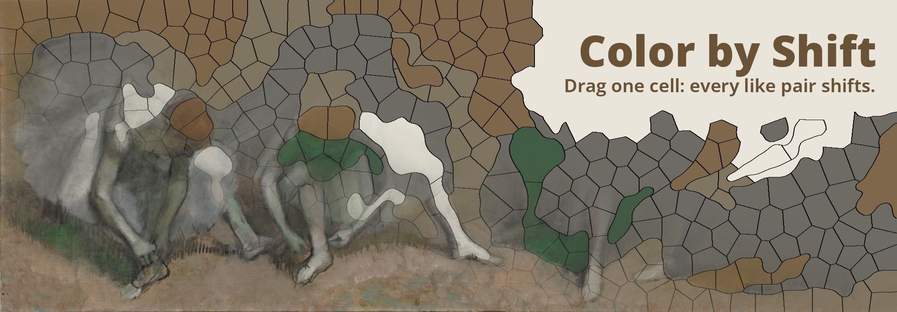

# Color by Shift



A puzzle game for GitHub Game Off 2026, theme **Shift**.
A game by Cy-3LO.

A painting has been scrambled on a foam of coloured cells. You cannot repaint a cell: you
can only drag a cell toward a neighbour, so that their two colours shift places. That swap
is repeated at once on every pair of the same kind across the picture. Undo the scrambling
and the painting comes back.

**Play in the browser:** *(itch.io link to come)*

## How to play

- **Drag** a cell toward one of its neighbours, with the mouse or a finger. Their two colours
  swap places, and so does every other pair of cells with the same two colours, wherever the
  same kind of edge joins them.
- While you drag, you see every pair that will swap. Let go before 60 % of the way and
  nothing happens; go further and the shift is played.
- Recover the picture: every cell back to its colour. The lines between the cells then fade
  and the real painting appears.
- The counter shows your moves over par, the fewest moves that solve the level. There is no
  score, no timer and no way to fail.
- Stuck? With hints on (in the settings), a cell of the next useful move is outlined in
  orange after 6 seconds without input. When the best move is to take back your last one,
  the hint points there.

| Control | Action |
|---|---|
| Drag a cell | Shift two colours across the whole picture |
| Undo / redo buttons, Z / Y | Take back a move, play it again |
| Back button, R | Rewind the level to its scrambled start (with no move played: previous level) |
| Next button | Next level |
| Level number | Grid of levels: grey solved, white with a lock still closed, orange current |
| Up / Down | Previous / next level |
| Escape | Close a panel |

Levels open one by one; once the 2-move levels are solved, all of them open. Progress and
settings (sound, hints) are saved in the browser.

## The rules behind it

- Every side shared by two cells belongs to exactly one **group**, and two sides of the same
  group never touch the same cell.
- A **move** is a group and two colours *a* and *b*: every pair of that group holding *a*
  and *b* swaps them, all at once.
- Whether a pair swaps depends only on its two colours, which the swap does not change. So
  every move is its own inverse, and a scramble is undone by the same moves in reverse order.
  No random numbers are used during play.
- Moves of different groups do not commute when they share cells, so the order matters, and
  a move that repairs one place disturbs another. That is the puzzle.
- Each level is scrambled by 1 to 4 moves. A search from both ends proves that it cannot be
  undone in fewer, so par is exact.

## The paintings

Fifteen public-domain paintings, each cut into regions of five colours. The foam is grown
inside the regions so that no cell crosses an outline.

| # | Painting | Source and licence |
|---|---|---|
| 01 | Piet Mondrian, *Composition with Red, Yellow, and Blue*, 1927 | The Cleveland Museum of Art, CC0 |
| 02 | Henri Matisse, *Dance (I)*, 1909 | rawpixel, CC0 |
| 03 | Paul Cezanne, *The Card Players*, 1890–92 | The Metropolitan Museum of Art, CC0 |
| 04 | Katsushika Hokusai, *Under the Wave off Kanagawa*, c. 1830–32 | The Metropolitan Museum of Art, public domain |
| 05 | Imitator of Ralph Albert Blakelock, *Moonlight* | National Gallery of Art, Washington, CC0 |
| 06 | Juan Gris, *Fantomas*, 1915 | National Gallery of Art, Washington, CC0 |
| 07 | Juan Gris, *Glass and Checkerboard*, c. 1917 | National Gallery of Art, Washington, CC0 |
| 08 | Alexej von Jawlensky, *Murnau*, 1910 | National Gallery of Art, Washington, CC0 |
| 09 | Ernst Ludwig Kirchner, *Dance Hall Bellevue*, 1909 | National Gallery of Art, Washington, CC0 |
| 10 | Hans Memling, *Tommaso and Maria Portinari*, c. 1470 | The Metropolitan Museum of Art, CC0 |
| 11 | Georges Seurat, *The Gardener*, 1882–83 | The Metropolitan Museum of Art, CC0 |
| 12 | Alfred Sisley, *The Road from Moret to Saint-Mammes*, 1883–85 | The Metropolitan Museum of Art, CC0 |
| 13 | Henry Ossawa Tanner, *The Seine*, c. 1902 | National Gallery of Art, Washington, CC0 |
| 14 | Félix Vallotton, *The Church of Souain*, 1917 | National Gallery of Art, Washington, CC0 |
| 15 | Félix Vallotton, *The Wind*, 1910 | National Gallery of Art, Washington, CC0 |

The banner above uses Edgar Degas, *Frieze of Dancers*, c. 1895 (The Cleveland Museum of
Art, CC0). Object numbers and links for every image are in
[assets/paintings/SOURCES.md](assets/paintings/SOURCES.md).

## Building from source

The game is made with [Godot](https://godotengine.org) 4.7.2 (GDScript, Compatibility
renderer). Its project is in [game/](game/).

```sh
# run the game
godot --path game

# web build (the export preset "Web" writes game/export/web/index.html)
godot --headless --path game --export-release "Web" export/web/index.html

# tests: the foam, the moves, the hints and the progress, checked against the Python twin
godot --headless --path game --script res://tests/run_tests.gd
# every level solved at par by simulated drags
godot --headless --path game -- --smoke
```

The levels are not built by the game. They are generated offline in Python and exported to
`game/data/`: foams, groups, scrambles with proven par, rasters of cells and cell outlines.

```sh
python -m venv .venv
.venv/bin/pip install -e ".[dev,tools]"
.venv/bin/python tools/make_ladder.py                           # build the levels of levels/candidates/ladder.toml, prove par
.venv/bin/python tools/export_godot.py --src levels/candidates  # export them to game/data
.venv/bin/python -m pytest                                      # Python tests
```

Other tools: `tools/make_sounds.py` synthesises the two sounds, `tools/make_cover.py` draws
the itch.io cover and banner, and `tools/fetch_icons.py` downloads the icons.

### Repository layout

```
game/          Godot project: sim/ (foam, level, session, hints, progress), scenes/, ui/, audio/, data/, tests/
model/         Python package mosaic_model (foam generator, solver) and its tests
tools/         level pipeline, export to Godot, sounds, cover and banner
levels/ grids/ level and foam files
assets/        painting scans and their sources, the font of the cover
docs/itch/     cover and banner of the itch.io page
toy/           pygame prototypes from the design phase
```

The repository also keeps the code of an earlier design, a reaction mosaic on a hexagonal
grid (the `mosaic_model` reaction modules, `toy/viewer.py`). The game does not use it.

## Credits

- Game: Cy-3LO.
- Paintings: see the table above; scans from the museums' open-access programmes.
- Icons: [Ionicons](https://ionic.io/ionicons), MIT licence, copyright Ionic
  ([game/data/licences/ionicons_LICENSE.txt](game/data/licences/ionicons_LICENSE.txt)).
- Engine: [Godot Engine](https://godotengine.org), MIT licence, copyright Juan Linietsky,
  Ariel Manzur and contributors.
- Font of the cover and banner: [Open Sans](https://github.com/googlefonts/opensans), SIL Open
  Font License ([assets/fonts/OFL.txt](assets/fonts/OFL.txt)).
- Sounds: synthesised for the game (a plucked string and a mallet chord).

## Licence

The code is under the MIT licence ([LICENSE](LICENSE)). The paintings are public domain or
CC0, as listed above; the icons and the font keep their own licences.
